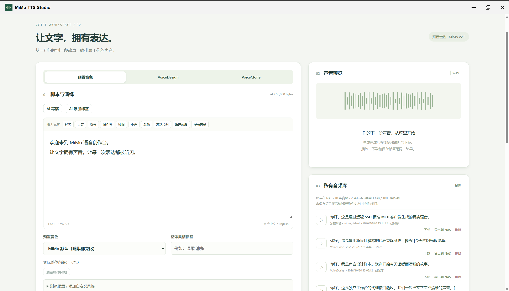
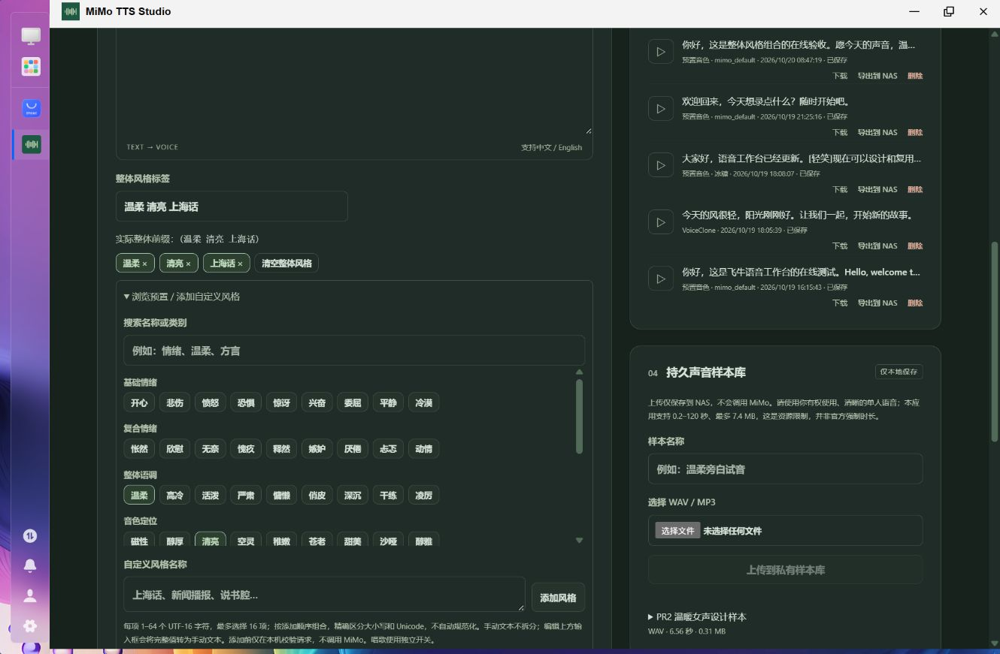
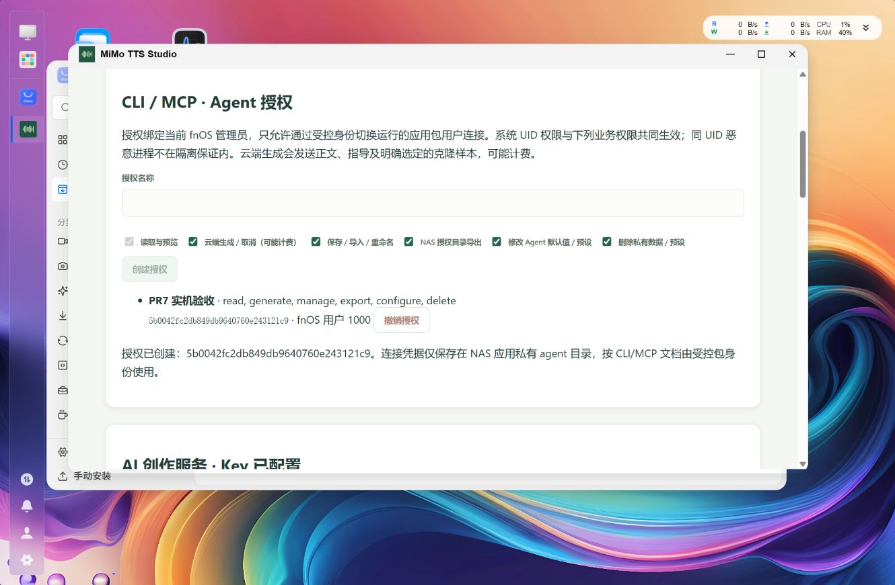

# MiMo TTS Studio

> **让文字，拥有表达。**  在飞牛 fnOS 上完成从文案构思、声音设计、语音合成到 NAS 音频归档的完整创作。

**MiMo TTS Studio** 是一款独立开发的 **fnOS 原生语音创作工作台**，基于小米 MiMo-V2.5-TTS，支持预置音色、**VoiceDesign 声音设计**、**VoiceClone 声音克隆**，并提供 AI 辅助创作、导演式表达控制、长文本配音、持久声音样本库及 NAS 文件导出。它既可以从 fnOS 桌面以浏览器界面使用，也可以通过 **CLI / MCP** 接入自动化脚本和 AI Agent。

**[下载最新版](https://github.com/787x/MiMo-TTS-Studio/releases/latest)** · **[CLI / MCP 使用指南](docs/CLI-MCP.md)** · **[开发与验收记录](verification/PR7.md)**

**适用平台**：飞牛 fnOS · Linux x86-64 · 原生 `.fpk` · 管理员访问。应用独立于 Windows [SeleVox](https://github.com/787x/SeleVox)，**不是小米官方产品**。



## ✨ 核心特色

- **三种声音创作模式**：选用预置音色、通过文字描述设计声音，或用 WAV/MP3 参考音频复刻声音。
- **从设计到克隆的连续工作流**：VoiceDesign 生成试音 → 试听满意后保存为持久样本 → VoiceClone 为新文本配音。删除最初的设计结果也不会删除已保存的样本。
- **让语音有表演感**：自然语言风格指导、角色/场景/指导导演模式、整体风格标签、句内音频标签，以及预置模式的唱歌功能。
- **AI 辅助编剧与配音**：六类 AI 创作任务先生成可预览的候选，用户确认后才修改稿件；AI 不会擅自开始收费的 TTS 合成。
- **真正面向 NAS**：浏览器试听、WAV 下载、私有音频与样本库，或直接将成品安全导出到 fnOS 已授权的其他共享目录。
- **Agent 原生接入**：37 项 CLI 操作、35 项标准 MCP stdio 工具，让 Codex 等 Agent 组合声音设计、长文本合成、资产管理与 NAS 导出。
- **清雅的深浅双主题**：深色模式延续现有灰绿、墨绿配色，只改变颜色，不改变工作台布局、尺寸和操作流程。

## 🎙️ 三种 MiMo 语音模式

| 模式 | 能做什么 | 适合场景 |
| --- | --- | --- |
| **Preset · 预置音色** | 选择 MiMo 预置音色，搭配自然语言风格、导演指令、整体/句内标签及唱歌 | 文章朗读、旁白、播客、短视频配音、歌词演绎 |
| **VoiceDesign · 声音设计** | 用自然语言描述想要的声线、口音、气质和说话方式，生成短试音 WAV | 角色声音探索、原创配音人设 |
| **VoiceClone · 声音克隆** | 使用私有样本库中的 WAV/MP3 参考音频，为新文字合成同类声线 | 固定角色声音、长篇配音、个性化旁白 |

预置音色包含 `mimo_default`、`冰糖`、`茉莉`、`苏打`、`白桦`、`Mia`、`Chloe`、`Milo`、`Dean`。默认音色的实际效果可能随云端模型变化。三种模式分别使用 `mimo-v2.5-tts`、`mimo-v2.5-tts-voicedesign` 和 `mimo-v2.5-tts-voiceclone`，**生成结果均为非流式完整 WAV**。

### 让声音按剧本演绎

- **自然语言说明**：直接写“语速舒缓、带轻微笑意、句末自然停顿”等指导。
- **导演模式**：分开填写**角色、场景、指导**；也可与自然语言说明组合，清楚预览实际发送内容。
- **整体风格标签**：8 类、48 项预设可搜索、多选、取消、移除和清空，也可以自由添加“上海话”“新闻播报”等名称。例如依次选择 `温柔`、`清亮`、`上海话`，实际前缀为 `(温柔 清亮 上海话)`。预设是创作辅助，**不是模型的支持白名单或效果保证**。
- **句内标签编辑器**：在光标或选区前插入 `[轻笑]`、`[叹气]`、`[深呼吸]` 等标签；保留原文、标点及 Unicode 文本边界。
- **唱歌**：仅预置音色模式支持，使用独立开关；避免把 `(唱歌)` 重复写入整体风格。
- **长文本**：按自然句与完整 Unicode 文本元素安全分段，单段目标可设为 **50–3000 个文本元素**，整体前缀与 UTF-8 预算纳入每段检查。可在生成前查看各段 `user` / `assistant` 内容，生成后合并为完整 WAV。

> VoiceDesign 以单段短文本设计声音，不会把长文反复“重新设计”成不同声线；长文请先保存设计样本，再通过 VoiceClone 合成。唱歌歌词建议尽量保持完整，分段可能影响韵律与连续性。

## ✍️ AI 辅助创作

在现有编辑区域直接使用六种 AI 功能：

| AI 操作 | 返回内容 |
| --- | --- |
| **完善音色描述** | 将简短人设扩展成适用于 VoiceDesign 的声音描述 |
| **生成自然语言风格** | 情绪、语气、速度、气息和停顿等指导 |
| **生成导演方案** | 结构化的角色、场景、指导三栏 |
| **写播报稿** | 可继续编辑的朗读正文 |
| **写歌词** | 预置音色唱歌模式下的歌词 |
| **添加句内标签** | 只插入合法标签，不改写原稿、换行或已有标签 |

AI 结果先展示为**候选内容**，支持预览、应用、放弃和恢复应用前文本。编辑或切换模式后的迟到回答不会覆盖新草稿。尤其是 AI 句内标签，后端会验证它**只能插入允许的标签**，不得擅自改字或破坏 Unicode/CRLF。

LLM 与 MiMo TTS **分别配置**。LLM 支持 OpenAI-Compatible Chat Completions、自定义模型、SSE 流式回答以及多种 Thinking 参数形式；官方 MiMo 便捷配置默认模型为 `mimo-v2.6-flash`。只有选择官方 MiMo 地址并主动启用复用时，LLM 才使用现有 TTS Key；其他兼容服务需要独立 Key。

**AI 生成文字 ≠ 生成语音。** AI 不自动应用草稿、不自动上传声音样本，也不自动调用 MiMo TTS。

## 🎧 声音样本库、音频库与 NAS 导出

**声音样本库**支持 WAV/MP3 上传、有效性校验、时长/大小展示、试听、重命名、选择及删除。参考文件仅在上传时保存在 NAS；**只有明确启动 VoiceClone 合成**，才会将选中的参考音频发送到 MiMo 云端。VoiceDesign 结果可以一键复制成独立持久的克隆样本。

**音频库**保留成功生成的 WAV 和生成模式/参数摘要，支持再次试听、下载、保存和删除。浏览器试听发生在访问页面的电脑或手机，**不依赖 NAS 声卡**；试听、下载、保存不会重新调用 MiMo。未保存结果在应用启动时清理超过 24 小时的条目，已保存音频与样本持续保留至主动删除。

**导出到 NAS** 可以直接将现有 WAV 复制到 fnOS 已授予读写权限的共享文件夹：

1. 在 fnOS 应用设置中授权目标目录，或使用应用内的原生目录选择入口。
2. 在结果/音频库中点击「导出到 NAS」，选择已授权目录、确认 WAV 文件名。
3. 导出后可在飞牛文件管理器及其他 NAS 媒体流程中使用这个独立副本。

导出不覆盖同名文件、不删除私有源音频、不重新合成；撤销授权或卸载应用也不会自动清理已经导出的外部文件。后端每次核实平台目录授权、用户 ACL 和应用实际写权限，并通过 Linux 安全文件操作避免路径穿越、符号链接逃逸和半成品冒充成功文件。

> **兼容要求**：NAS 目录导出需要 fnOS **1.2.0401+** 的目录开放 API，已在 **1.2.0800** 验证。仅安装了较旧 fnOS 时，其他创作功能仍可使用，目录导出可能不可用。



## 🤖 CLI / MCP：把创作工作台交给 Agent

**v0.7.x 引入独立的 Linux 自包含 `MiMoStudio.Agent` 程序**，同一程序提供 CLI 和标准 **MCP stdio Server**，使用官方 MCP C# SDK。**37 项 CLI 操作、35 项 MCP 工具**覆盖：

| 能力 | CLI / MCP 可以完成的操作 |
| --- | --- |
| 语音生成 | Preset、VoiceDesign、VoiceClone、唱歌、导演、整体/句内标签、长文本与生成前预览 |
| AI 创作 | 六类 LLM 候选生成与严格标签插入校验 |
| 任务 | 提交、查看进度、等待、取消；返回 Job ID，后台任务不依赖 CLI 持续连接 |
| 声音样本 | 列表、详情、由 Design 成品建样本、重命名、删除及按 ID 克隆 |
| 音频资产 | 列表、详情、保存、删除，以及受控下载/导出 |
| NAS 文件夹 | 列出当前授权目标、按目录 ID 安全导出 WAV |
| 服务检测 | 离线配置预检查、主动真实检测 MiMo 三模式及 LLM |
| Agent 预设 | 默认参数、命名预设与单次覆盖，按权限管理 |

CLI 另有两项本机受控文件操作：`import_sample`（导入 WAV/MP3）和 `download_asset`（保存 WAV 到指定新文件）。**MCP 不提供任意宿主文件读取、远程音频 Base64 输出或任意路径写入。**

示例：以下假设已按文档由管理员创建授权，并配置好以 **应用包用户**运行、能读取专用授权凭据的 `agent` 命令包装器：

```bash
# 先核对真正发往 MiMo 的参数与分段，不会调用云端
agent preview_synthesis --text '你好。[轻笑]欢迎回来。' --voice 冰糖 --tags '温柔 清亮'

# 使用设计描述生成短试音，随后把成品保存为克隆样本
agent synthesize_audio --synthesis-mode design \
  --voice-description '成熟温暖的成年女声，普通话自然清晰' \
  --text '欢迎来到今晚的故事时间。' --wait
agent create_sample_from_asset --id DESIGN_ASSET_ID --name '电台女声'

# 使用样本配新台词，并交给 NAS 后端异步生成
agent synthesize_audio --synthesis-mode clone --source-sample-id SAMPLE_ID \
  --text '这是一段新的旁白。' --tags '温柔' --request-id story-001
agent get_job_status --id JOB_ID --wait

# 将已完成 WAV 导出到 fnOS 当前授权的文件夹
agent list_nas_export_targets
agent export_audio_to_nas --id ASSET_ID --directory-id TARGET_ID --file-name story.wav
```

Agent 与 Web **共用同一个后端、Jobs、样本库和音频资产**：Agent 生成的 WAV 可以回到网页试听，不会出现两套互不相通的库。TTS 提交可使用 `requestId` 在**同一授权、同一后端进程内**防止重复提交；**应用重启后不保证跨进程幂等**。

### 授权与远程 MCP

管理员在 Web 设置 → **CLI / MCP · Agent 授权**中创建授权。它绑定可信 fnOS 创建者和操作范围：`read`、`generate`、`manage`、`export`、`configure`、`delete`；支持撤销。Linux **包用户 UID + 0600 私有 Unix Socket + 私有凭据 + 操作 scope** 共同校验。普通 SSH 用户直接执行 CLI 并不会自动获得访问权，也不会因能启动 MCP 就绕过 fnOS 授权。

标准 MCP 通过 **stdio** 接入，支持本机启动或通过可信 SSH 在 NAS 上启动；远程使用需要已配置好的 SSH 与**受控、非交互的包身份切换能力**，**不是任意 SSH 用户开箱即用**。不会额外开放网络 TCP/MCP 服务。示例、权限设置、35 项工具 Schema 与错误代码见 **[CLI / MCP 完整指南](docs/CLI-MCP.md)**。



## 🩺 服务可用性检测与深浅主题

设置中的服务检测分别覆盖 **Preset、VoiceDesign、VoiceClone、LLM**。打开面板仅检查配置完整性；用户明确点击“检测”才发送一次固定短请求。TTS 需获得有效音频，LLM 需返回完整正常的最终回答才能显示成功。VoiceClone 检测需要主动选定参考样本，不会自动上传声音；检测不创建持久音频或新样本，**真实检测仍可能计费**。

浅色和深色模式即时切换，保持原字体、间距和左右工作台布局。主题偏好仅保存到当前浏览器，不上传至 NAS 账户设置；切换或刷新不影响已生成的音频。

## 📦 下载与安装

从 **[GitHub Releases · latest](https://github.com/787x/MiMo-TTS-Studio/releases/latest)** 下载

**快速开始**：

1. 使用 **fnOS 管理员**登录 → 应用中心 → **手动安装**，上传 `.fpk` 并完成安装；升级同样可在应用中心上传新版本。
2. 从 fnOS 桌面点击 **MiMo TTS Studio** 图标打开工作台。
3. 在设置中填写自己的 **MiMo API Key**；需要 AI 写稿时再配置 LLM 服务及 Key。
4. 选择模式、音色和风格，编辑正文 → **预览最终请求** → **生成语音**。
5. 在浏览器试听、下载 WAV，保存至私有音频库，或经 fnOS 授权导出到 NAS 目录。
6. 需要 Agent 自动化时，先在 Web 设置创建 Agent 授权，再按 CLI/MCP 文档配置受控包身份和 stdio 客户端。

**兼容说明**：Manifest 声明的最低 fnOS 版本为 `1.1.3100`，实际验收环境为 **fnOS 1.2.0800 / x86-64**，未验证全部较旧版本；NAS 共享目录导出额外需要 **1.2.0401+**。安装包自带 .NET 运行时，NAS **不需要**额外安装 .NET SDK、Node.js、Python、ffmpeg、Docker 或数据库。

## 🛠️ 从源码构建

构建依赖：**.NET 10 SDK、Node.js 24/npm、Python 3、Bash 和官方 fnpack 1.2.3**。确保 fnpack 来自 [fnOS 开发者平台](https://developer.fnnas.com/docs/)。

```bash
# 在 Linux x86-64 上
bash scripts/build.sh
```

```powershell
# Windows + WSL Ubuntu，按仓库包装脚本的环境要求准备工具
./scripts/build.ps1
```

构建生成 `artifacts/mimotts.fpk`，自动完成前端构建、两个 .NET Linux 自包含发布、许可收集和 fnpack 打包。WSL 和 Windows 共享工作目录时，不要并发使用同一组 .NET `obj` 文件；Linux 端 `node_modules` 应独立执行 `npm ci`。

技术结构：**Vue 3 + TypeScript** 前端、**ASP.NET Core / .NET 10** 后端、独立 .NET 10 Agent 程序、fnOS **统一网关 + Unix Socket**。所有 Web API 经可信 fnOS 管理员身份、Origin/CSRF 保护；Agent 使用单独私有 IPC，不直接伪造 Web 网关身份。

## 🔐 隐私、费用与使用边界

- **云端处理**：主动生成语音会发送文本、风格及必要参数；VoiceClone 还会上传选定参考音频。主动 AI 创作会向配置的 LLM 发送本次所需文本。云端服务可能收费，取消已发出的请求也不保证免计费；应用不自动重试可能计费的请求。
- **凭据**：TTS/LLM Key 和 Agent 凭据存储在 NAS 的应用私有目录，使用文件权限保护，**不是加密保险箱**。浏览器和 MCP 不能读取明文 Key。请仅在受信任的 fnOS/SSH 环境中使用。
- **文件**：持久资产与声音样本隔离存储，生成失败或取消不提交成功 WAV。对共享文件夹的导出仅使用 fnOS 当前授权范围，不覆盖已有文件。
- **声音权利**：仅使用自己有权上传和克隆的参考声音。模型生成的声线、方言、演唱和克隆相似度受模型与输入影响，不作固定效果保证。
- **暂不提供**：浏览器录音、实时低延迟音频流式播放、MP3 音频导出、云端永久 Voice ID 训练、音色市场、远程 HTTP MCP 服务和任意 NAS 文件管理。MP3 仅用于克隆样本输入。

## ✅ 测试与已知限制

项目保留各阶段实际验收记录：[PR1](verification/PR1.md) · [PR2](verification/PR2.md) · [PR3](verification/PR3.md) · [PR4](verification/PR4.md) · [PR5](verification/PR5.md) · [PR6](verification/PR6.md) · [PR7](verification/PR7.md)。

PR7 阶段已在真实 **fnOS 1.2.0800** 验证安装升级、Web/CLI/MCP 共用资产、真实三模式 MiMo、六类 LLM 创作、SSH MCP、撤销授权及 NAS 导出。**v0.7.2** 的修复额外完成 Linux/WSL 受控回归、真实 UDS 与 SDK MCP 客户端检查及发布包结构/许可检查，完整证据和剩余验证事项见 [verification/PR7.md](verification/PR7.md)。

## 📄 许可与致谢

项目源代码采用 **GNU GPL-3.0**，详见 [LICENSE](LICENSE)；打包时保留第三方依赖的对应许可及声明（见 [third_party/](third_party/)）。本项目独立开发，参考小米公开的 [MiMo-V2.5-TTS 文档](https://mimo.mi.com/docs/zh-CN/quick-start/usage-guide/audio/speech-synthesis-v2.5)、[MiMo LLM 文档](https://mimo.mi.com/docs/zh-CN/api/chat/openai-api) 和 [fnOS 开发者文档](https://developer.fnnas.com/docs/)，并只读参考 [SeleVox](https://github.com/787x/SeleVox) 的相关功能设计。
