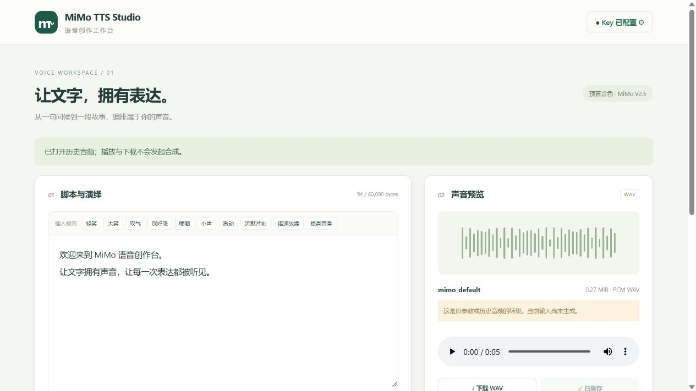

# PR1 验证记录

日期：2026-10-19（Asia/Shanghai）。记录独立仓库的实际证据，不把受控 HTTP、WSL、FPK 打包、真实 fnOS 和真实 MiMo 混为同一层级。

## 实现

- .NET 10 自包含 Linux x86-64 后端、Vue 3 / TypeScript 工作台、fnpack 原生包；生产仅 Unix Socket，不依赖 Node 常驻、Docker、数据库或 NAS 声卡。
- 官方非流式 MiMo 协议、九种预置 Voice、自然语言/导演/组合指导、整体/句内标签、唱歌前缀、Unicode 与标签安全分段、最终请求预览。
- 有界单任务、真实取消传播、WAV 校验与 PCM16 规范化、原子资产提交、浏览器播放/范围请求/下载/保存复用、按可信 UID 隔离的私有库。
- root Socket 对端身份与管理员 Header 双重检查，Origin/CSRF，私有 Key 权限、文件 ID 与配额边界，启停防双实例与保留/删除生命周期。

## 构建和受控验证

| 项目 | 实际结果 |
| --- | --- |
| 前端 | Windows Node 24.19.0；`npm ci`、`vue-tsc --noEmit`、Vite 8.3.4 生产构建成功 |
| 依赖审计 | `npm --prefix frontend audit --audit-level=high`：0 vulnerabilities |
| .NET | WSL Ubuntu .NET SDK 10.0.112；Release 构建、linux-x64 自包含 publish 成功，携带 .NET 10.0.12 |
| 协议/存储 | `dotnet run --project tests/Studio.Tests.csproj -c Release`：49 项检查通过 |
| Release 接入 | `sudo python3 tests/production_gateway.py artifacts/fpk/app/server/MiMoStudio`：19 项检查通过 |
| 生命周期 | `python3 tests/lifecycle.py`：5 项检查通过，包含保留恢复、确认删除、无关文件不变与 symlink 拒绝 |
| 官方打包 | 使用实际 `fnpack create` 模板核对，`fnpack 1.2.3 build` 成功 |
| 包内容 | `python tests/package.py`：Manifest 架构、脚本权限/LF、网关、包用户、ELF、自包含运行时、静态 UI、第三方许可、无 Key/半成品/Windows 工程引用检查通过 |

49 项检查覆盖 user/assistant 角色、音色、非流式字段、导演/唱歌前缀、原文及 CRLF/组合字符/ZWJ/标签还原、UTF-8 预算、JSON/Base64/WAV 错误、响应长度限制、PCM 合并及双声道转换、采样率不一致拒绝、单并发/取消/失败、保存重启/删除、所属用户、私有 Key 与恢复权限。Mock HTTP 的播放/读文件/保存后调用计数不增加；它不能证明云端账单或声音表现。

19 项接入检查启动真正 Release 二进制，以非 root 包身份监听 Unix Socket，由 root 测试客户端模拟可信网关。验证缺失身份、非管理员、伪造 Header 的非 root 对端、UI/API 保护、CSRF/Origin、路径穿越、请求体上限、Key CRUD 和零 Key 回显。即便设置 Development 和 MIMO_DEV_LOCAL，Release 仍不开启开发认证例外。此项是 Linux 接入测试，并不替代真实 fnOS 会话测试。

## 真实 fnOS

指定测试设备为 Linux x86-64，系统 `/usr/trim/etc/version` 为 **1.2.0800**，内核 `6.18.18.c1126-trim`，Debian 12 用户空间；应用中心 CLI 1.0.2。测试凭据和真实 Key 未写入仓库、日志或本记录。

- 通过设备原生 `appcenter-cli install-fpk` 实际安装 FPK；管理员浏览器登录后，从 fnOS 桌面图标打开 `/app/mimotts/` 的 iframe，静态 UI 与 API 正常。
- `tests/fnos_acceptance.py` 在真实设备运行，最终版 **24 项检查通过**：包用户运行、0600 Socket、main status、重复 start 同一 PID、非管理员 Header/缺失身份拒绝、Origin/CSRF、资产归属、路径穿越、静音测试资产保存/播放字节/下载/206 Range/删除、停止释放 Socket、status=3、重新启动、已有 Key/已保存资产保留与 Key 0600。静音测试资产有明确标签，已清理，不是 MiMo 合成证据。
- `ldd` 核验 apphost、OpenSSL 与压缩库，没有缺失链接依赖；真实 HTTPS 合成进一步验证系统 TLS/证书环境。invariant globalization 避免依赖 ICU。
- `ss -ltnp` 未发现 MiMoStudio 的 TCP 监听。Socket 是 `TRIM_APPDEST/app.sock`，实际网关对端为 root；普通本地用户不能靠伪造 Header 取得访问权。
- 对公开 fnOS 网关发送无会话但伪造管理员 Header 的请求，系统返回 **HTTP 200 / `invalid token`**，没有返回音频库。该平台的拒绝不是 HTTP 401/403，不能只看状态码。
- 使用最终卸载钩子的默认保留分支，真实卸载再安装最终 FPK，核对 Key 与一条已保存真实音频的 SHA-256 在前后相同；未输出 Key 内容或 Key 哈希。最终钩子与后端 DLL 也与发布暂存产物核对。

实机发现并修复的兼容问题：网关的 Host 丢失端口，写操作需结合完整 Referer 与独立 CSRF；包用户无法读取自身 `/proc/PID/exe`，状态改用 cmdline 与 kernel start ticks；平台重装会把保留文件设为 0700，后端启动恢复 Key 到 0600。

设备 CLI 对已安装应用直接返回 installed，未执行原位升级。CLI 1.0.2 也拒绝带向导的卸载；为自动验收默认 keep 钩子，测试时暂移了本应用卸载向导，再走 CLI 卸载/重装；最终 FPK 已恢复向导。本次完成的是保留数据卸载/重装与升级钩子测试，**不能称为应用中心完整原位升级或 GUI 卸载选择实测通过**。GUI 上传已走到第三方免责声明，没有代替用户接受该声明。

## 真实 MiMo 与浏览器

用户在测试机设置界面配置 Key 后，工作台显式执行 **一条**中英混合文本请求：

```text
user: 请自然、清晰地朗读，中文和英文之间稍作停顿。
assistant: (温柔 清亮)你好，这是飞牛语音工作台的在线测试。Hello, welcome to MiMo Studio.
voice: mimo_default
```

任务成功并提交合法 WAV：**284204 bytes、24 kHz、单声道 PCM16、5.92 秒**。浏览器播放控件进入播放并到达末尾，保存至私有库，实际下载后用 Python wave 复核；下载 SHA-256 为 `3c3de847b6c03da5bfcfd4895a1ba77f2c15d80f468d33664b584c5ed357390c`。这确认媒体解码/播放控件与文件格式，未宣称人工听感、发音准确率或导演质量评分。

同一资产保存、浏览器试听与下载均使用资产 API；没有再次按生成按钮。Mock 调用计数及端点职责验证零额外合成，未直接审计小米账单。重启、保留卸载与重装后，从私有库仍能打开相同结果，并明确提示当前是历史参数结果。



## 仍未实测的范围

- 独立非管理员 fnOS 账号登录及其伪造身份 Header 场景：当前覆盖了真实服务的非管理员 Header、非 root Socket 对端及真实网关无会话伪造，但没有第二个 fnOS 登录会话。
- fnOS 应用中心原位升级全流程、GUI 卸载确认删除分支、最小声明系统 1.1.3100、ARM、FN Connect 外网/HTTPS 反向代理兼容性。
- 云端长文本多段、导演/唱歌的人工听感与全部九个音色。相应协议/分段/取消/错误由受控测试覆盖，真实云端只执行上述短样本。
- 生成期间 NAS 断电、磁盘耗尽、最大 64 MiB 音频的资源峰值与长时间负载压测。边界已实现，不将代码检查当作这些场景的实测。

## 最终产物

`artifacts/mimotts.fpk`，版本 **0.1.3**，`platform=x86`，49,307,505 bytes。SHA-256：`30e60e212433c36031c96bd7d1fce4a39593e69c21ba0347c895a3548e60772f`。最终包已实际安装并重新运行设备验收；二进制产物不进入 Git 历史，开发者可通过 README 的脚本重新构建。
