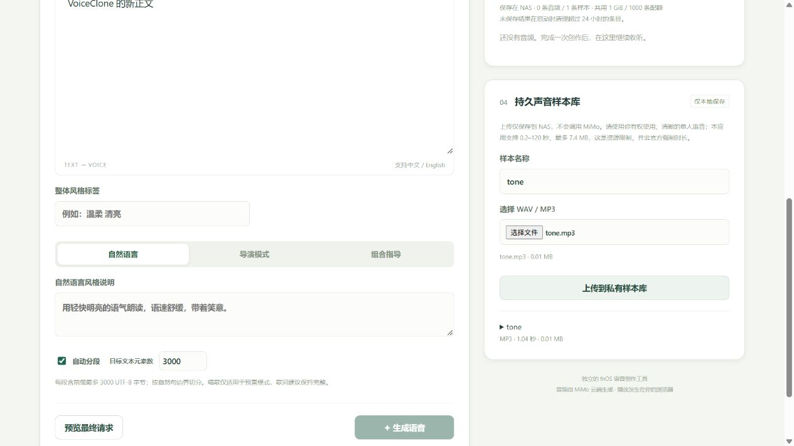
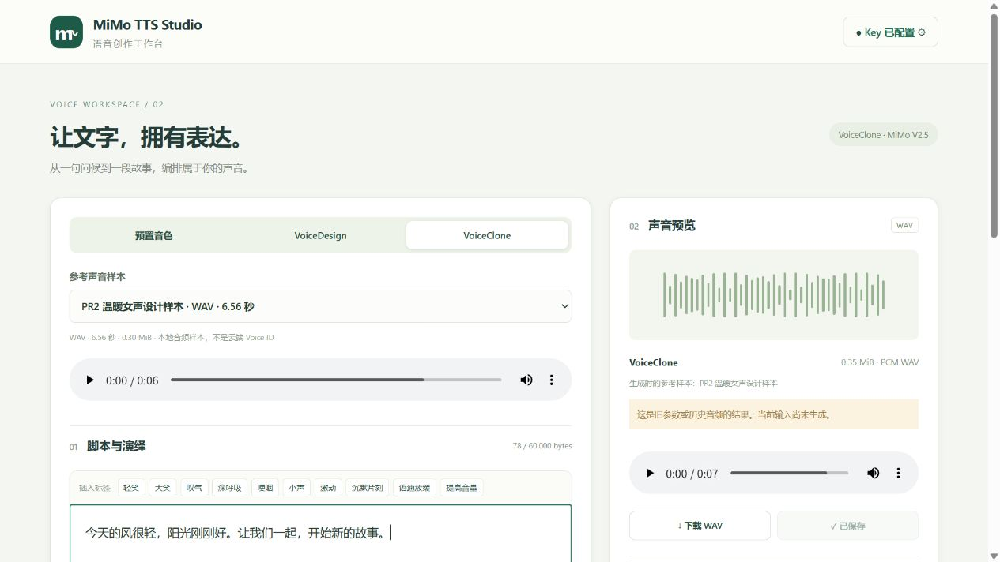

# PR2 验证记录

日期：2026-10-19（Asia/Shanghai）。基线为最新 `main` 的 PR1 合并提交 `0d118bb`，保留 PR1 的真实设备、云端和文件证据。开发分支 `codex/pr2-voice-library`。

## 交付与边界

- 在现有 Composition/Mimo/Jobs/Storage 上扩展三模式，普通请求缺省仍是预置模式，旧资产缺省仍按预置结果读取。
- VoiceDesign：必填描述进入 user、播报原文进入 assistant，单次短试音，不带 voice，显式关闭 `audio.optimize_text_preview`。本版拒绝开启优化；无唱歌或整体标签专属控件，不将多次随机设计伪装成固定音色。
- VoiceClone：后端从所属用户的样本 ID 取得完整快照，构造正确 MIME 的 Data URL；后续改名/删除不会改变运行中任务。原有分段、取消、响应上限、WAVE 校验及原子提交共用。
- 持久样本库：独立副本、命名/改名/试听/选择/删除、来源及音频实际元数据。生成结果和样本共用 1 GiB / 1000 条限额。默认卸载保留，确认删除只清理归属标记下的已知私有子目录，并拒绝 symlink。
- 普通 API 仍为 128 KiB。只有样本上传路由放宽为 7,400,000 字节，先鉴权/Origin/CSRF，再有界流读取与实际格式校验；最多两个样本处理、30 秒超时。
- MP3 使用随包分发的 NLayer 3.0.0（MIT），检查完整连续 Layer III 帧并逐帧解码，检查有 CRC 的帧，不依赖 NAS 上的 ffmpeg/NAudio 或 Windows 音频组件。许可见 `third_party/NLayer.LICENSE`。
- 三模式各自保留编辑草稿与结果槽，结果展示实际模式和参数；修复组件卸载后 in-flight finally 再安排轮询的问题。

## 已执行的构建与受控测试

| 层级 | 命令 / 实际结果 |
| --- | --- |
| 前端 | `npm --prefix frontend run build`：vue-tsc 与 Vite 8.3.4 生产构建成功 |
| .NET | WSL Ubuntu SDK 10.0.112，Release 与 linux-x64 自包含 publish 成功，0 构建警告 |
| 受控协议/文件/任务 | `dotnet run --project tests/Studio.Tests.csproj -c Release`：**99 项检查通过**（保留 PR1 的 49 项） |
| Release 接入 | `sudo python3 tests/production_gateway.py artifacts/fpk/app/server/MiMoStudio`：**37 项检查通过** |
| 生命周期 | `python3 tests/lifecycle.py`：**6 项检查通过** |
| 前端定时器 | `node --test frontend/tests/polling.test.mjs`：**2 项通过**，包含请求未完成时卸载、空闲 timer 卸载 |
| 依赖审计 | npm audit：0 vulnerabilities；`dotnet list ... package --vulnerable --include-transitive`：当前源未发现易受攻击依赖 |
| FPK | fnpack 1.2.3 实际打包成功；`python tests/package.py` 校验架构、网关、脚本权限、ELF/自包含、NLayer 与依赖许可、无 Key/半成品/Windows 项目依赖 |
| 真实 fnOS | `tests/fnos_pr2.py` 在指定测试机执行：**32 项检查通过**，含原位升级与重启/样本验证 |

99 项检查验证三模型 JSON 差异、显式不优化/不改正文、不支持控制字段拒绝、WAV 与 MP3 MIME/时长、空/超限/截断/坏帧/CRC/伪装格式、MP3 MPEG2 stereo VBR + ID3/Xing、Data URL 大小预算、PR1 无新字段的 JSON、源资产删除与重启后独立样本可用、样本归属、改名/删除与运行中多段任务的快照竞争、取消/失败零成功资产、样本共享磁盘配额和参数摘要无 Key/Data URL。

37 项接入检查运行真正 Release 二进制，包用户监听真实 Unix Socket，root 测试客户端模拟可信网关。验证普通 JSON 128 KiB 限制、192044-byte 合法 WAV 上传、chunked MP3 上传、错误格式/空/超限上传、样本 CRUD 与归属、下载复用、Origin/CSRF、路径穿越、无 Header/非管理员/非 root 对端拒绝、Release 无法打开开发免认证开关。没有接入真实云端，不以此替代设备会话或云端合成。

生命周期检查包含新增 samples 的默认保留、删除分支和 symlink 拒绝；删除不影响无关目录。它是临时目录测试，尚不能等同于 fnOS GUI 卸载选择实测。

## 浏览器本地验证

在仅绑定 localhost 的显式 Debug 开发服务上，通过真实浏览器操作验证：

- 预置模式输入 Unicode/换行与风格，切到 VoiceDesign 输入独立描述和正文，再切到 Clone 编辑新正文；回切后前两种草稿保持原值。
- Design 不展示预置音色、唱歌或整体标签控件；Clone 不展示唱歌，明确显示参考音频将随生成上传云端。
- 使用原创正弦波 MP3 通过真实文件选择器上传，样本显示 MP3、1.04 秒、实际大小，并自动选择到 Clone；现有 Clone 草稿未覆盖。
- 未配置开发 Key，生成保持禁用；上传/选择/预览没有触发云端合成。

这部分是本地浏览器 UI 证据，不是 fnOS 或真实 MiMo 的完成证据。

## 真实 fnOS 原位升级与样本操作

用户确认应用中心第三方声明后，在 **fnOS 1.2.0800 / Linux x86-64** 的应用中心完成 `0.1.3 → 0.2.0` 原位更新，UI 明确进入“更新中”流程。安装版本、服务运行身份与包内服务 DLL 的 SHA-256 均核对一致。升级前后 Key 文件的私有哈希及全部一条已有 WAV 的哈希保持一致；旧资产仍能列出、试听和下载。未打印或提交 Key 内容/哈希。

实机收尾发现已完成的其他模式任务状态会留在当前历史结果上方。`0.2.1` 只修正此显示判断并去除重复模式名称，保留运行中其他模式任务的取消入口，没有改变后端合成协议。随后应用中心执行 `0.2.0 → 0.2.1` 更新，逐字节核验 **Key、三条生成音频、一条设计参考样本及其名称/来源元数据** 保留；最终版本再次完成同一组 32 项设备验收。

`tests/fnos_pr2.py` 在真实设备执行 **32 项通过**：版本迁移、Key/原 WAV 哈希与可访问性、包用户、0600 Key/Socket、实际 WAV/MP3 校验、格式伪装及截断拒绝、普通 JSON 128 KiB、上传端点更大 Body、Origin/CSRF、样本用户归属与路径穿越、改名/下载字节复用、无新增生成任务、重启后样本与名称保留、删除一份样本不影响另一份。此脚本只管理明确标记的静音/正弦波测试文件，不调用 MiMo、不更改已有 Key。

管理员通过升级后的 **fnOS 桌面图标和 iframe** 打开三模式工作台。另通过浏览器真实文件选择器，经公开网关上传 **192044-byte / 4 秒 WAV**（大于普通 API 128 KiB 上限）及 **12539-byte / 1.04 秒 MP3**，显示实际格式/大小/时长、自动选择到 Clone，浏览器试听及 UI 改名成功。改变所选参考样本时，旧克隆结果明确标为历史参数结果。上传仅产生本地样本，没有新增 TTS 任务。两个测试上传样本已按 ID 清理，设计样本、原有和新生成音频保留。

## 真实 MiMo 三模式与 Design → Clone

在 `0.2.0` 使用用户已经配置在服务端的 Key，显式执行三次短文本在线生成，每种模型一次；均成功生成 **24 kHz、单声道 PCM16 WAV**。后续 `0.2.1` 仅修补前端状态显示，未再次收费合成：

| 模式 | 实际输入与结果 |
| --- | --- |
| VoiceDesign | 描述：成年女性、标准普通话、温暖沉稳醇厚、自然清楚、语速舒缓；正文“你好，这是新设计的声音。愿你今天轻松愉快。”；**314924 bytes / 6.56 秒** |
| VoiceClone | 使用上述设计样本，正文“今天的风很轻，阳光刚刚好。让我们一起，开始新的故事。”，自然语言指导保持参考音色、温暖清晰；**368684 bytes / 7.68 秒** |
| 预置回归 | `冰糖`，自然语言＋角色/场景/指导的组合模式、整体 `(温柔)`、正文句内 `[轻笑]`；**307244 bytes / 6.40 秒** |

Design → Clone 的真实顺序：

1. 在 VoiceDesign 编辑并预览 user/assistant 后生成，浏览器试听。
2. 命名“PR2 温暖女声设计样本”，点击保存为克隆样本并自动切到 Clone。核验独立副本字节与原设计 WAV 相同，仍只有一个设计任务。
3. 通过受保护资产 API 删除本次设计原结果，确认原结果变为 404、独立样本保持相同 SHA-256；随后真实停止/启动应用。
4. 重开工作台选择重启后仍存在的样本，输入新正文/风格，预览 `mimo-v2.5-tts-voiceclone` 后生成成功；任务和资产摘要记录正确样本 ID/名称，没有 Data URL 或 Key。
5. 浏览器试听、保存并实际下载克隆 WAV，Python wave 复核完整文件。该阶段只有一项 Clone 任务；试听/下载/保存及样本操作未新建生成任务。随后额外预置回归恰好增加一项 preset 任务。

克隆下载 SHA-256：`b902e70f92a9cde8913d9690fee2bc4a63edee9f398d3bba4e4e0320ccf9dbab`；预置下载 SHA-256：`0b42b2d7e1fe3cd363ea53dd6f5eb10f915982128fed95607749e9f0c7eb1ed8`。浏览器媒体控件完成播放，确认技术解码/播放流程；未宣称人工音色相似度或自然度评分，也未直接审计小米账单。

## 当前产物

最终 FPK **0.2.1**，Linux x86-64，自包含；Manifest `platform=x86`，49,368,727 bytes。

路径 `artifacts/mimotts.fpk`，SHA-256：`328481951f3ae4bc37fe879bd3a6db8336c8241141e220511f258ef15c402878`。二进制不提交 Git，可按 README 重建。首次原位升级及云端验证使用的 0.2.0 包 SHA-256 为 `24249c06c2be61917c3881f7592e497919e988bed9e07a5565a6e0a16fe5c803`。

另验证了发布明确排除本地 `.dev/` 状态与临时 `backend/wwwroot` 预览内容；在存在本地样本后重新 publish 的服务 DLL 与包内 DLL SHA-256 一致，包内无样本元数据或凭据。

## 尚未验证 / 局限

- 独立非管理员 fnOS 登录会话、GUI 卸载确认删除、最小声明系统版本、外部 HTTPS/FN Connect 接入仍未实测。
- 云端多段长文本克隆、MP3 参考的真实在线克隆、全部音色/标签的人工听感未实测；多段快照、MP3 Data URL MIME 与错误/取消边界由受控测试覆盖，真实在线克隆使用 WAV 设计样本。
- 无 CRC 的 MP3 中，无法保证检出仍可合法解码的所有位变化；free-format、改变采样率/声道或不识别尾部数据会拒绝。按帧计算的时长包含编码延迟/填充。
- 极限大小/持续并发的 CPU/RAM 压测、NAS 断电及磁盘耗尽未实测；已有请求、时长、并发、响应和容量保护。
