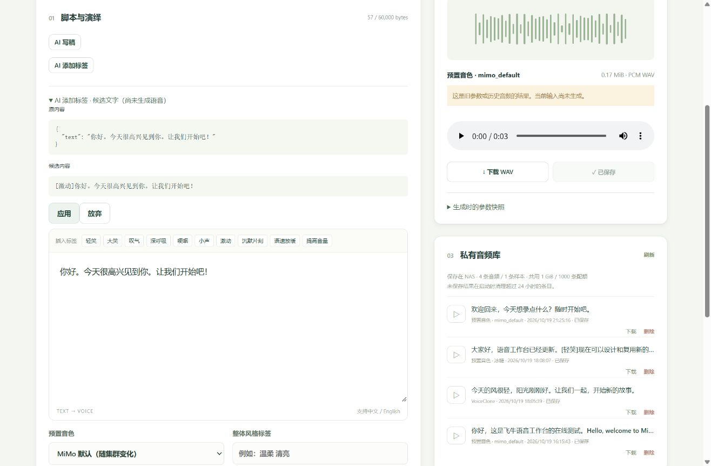
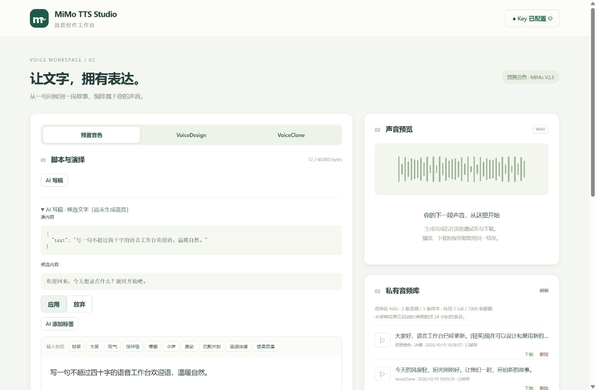

# PR3 验证记录

日期：2026-10-19（Asia/Shanghai）。基线 `origin/main` / PR2 合并提交 `494f36d`，分支 `codex/pr3-ai-creation`。新增代码独立实现，没有复制 SeleVox 源码。

## 实现

- 独立 LLM 私有配置与凭据、官方精确地址显式复用 TTS Key、自定义地址凭据隔离；原子写入与 Linux 0600。保留卸载/重装新增 `llm-private`，升级不覆盖。
- 六项操作独立 Prompt，共用有界 HTTP、取消、超时与严格完成校验；不使用 TTS Jobs，不读取或发送音频/样本。不重试，不接受截断、空正文、reasoning、工具调用或错误流。
- 导演严格三字段 JSON，按 Composition 组合预算校验。标签使用原始 Unicode 文本元素及方括号原子单元，验证只能插入目录标签，重复标签也可接受。
- 候选先预览再主动应用；按完整草稿及修订版本丢弃迟到响应，三栏原子应用/恢复，恢复保护后续编辑。保持既有左右工作台和音频历史快照。
- 官方默认 LLM `mimo-v2.6-flash`；Thinking 支持省略、MiMo type、enable_thinking 与 reasoning_effort，按所选协议显式发送，不自行探测或降级重试。

## 受控验证

| 层级 | 实际执行结果 |
| --- | --- |
| 前端 | Vue 类型检查及 Vite 生产构建成功 |
| .NET | Windows Release 153 项、WSL Linux Release 156 项检查通过；Linux 多出私有权限检查 |
| 前端组件 | Vitest + Vue Test Utils / happy-dom：8 项通过，含应用/恢复、导演三栏、编辑/样本切换/取消/卸载迟到响应 |
| 原有前端 | Node polling 测试 2 项通过 |
| Release Socket | 49 项通过，含非 root 对端/非管理员拒绝、Origin/CSRF、普通请求限制、LLM 配置隐藏 Key、清除凭据、本地 HTTP 显式授权与真实 loopback 兼容请求（独立 Key、恰好一次，无 audio）及原有样本回归 |
| 生命周期 | 6 项通过，新增 LLM 保留恢复/0600 检查，确认删除范围与 symlink 拒绝 |
| 打包 | Linux x86-64 自包含 publish、fnpack 1.2.3 与 `tests/package.py` 通过 |
| 前端依赖 | npm 安装及生产依赖审计：0 vulnerabilities |

后端 AI 定向覆盖：服务地址和 Key 隔离、显式复用边界、Thinking 请求、不含 audio、非流式与完整 SSE、缺 DONE、截断、结束后错误、推理隔离、429 无重试、空/无效/过大响应、取消、并发与总/首响应超时。Unicode 包括组合字符、ZWJ Emoji、CRLF、原有/重复标签、非法标签与原稿改写拒绝。上述为受控 HTTP 与临时目录测试，不能代替真实云端或设备验证。

## 真实设备

测试机 fnOS 1.2.0800 / Linux x86-64。通过应用中心「手动安装 → 从电脑上传」实际执行 `0.2.1 → 0.3.0` 原位更新，随后修正真实响应空工具字段兼容问题更新至 `0.3.1`，再将标签操作改用独立严格插入 Prompt，最终版本为 `0.3.2`。CLI `install-fpk` 对已安装应用只报告 installed，未执行升级；没有把该输出记为升级成功。

升级前在设备私有文件中记录原 TTS Key、三条音频和一条声音样本及元数据，共 9 个文件的校验值。0.3.0 / 0.3.1 / 0.3.2 升级后逐文件一致，原库可访问，Socket/Key 0600、Release 无开发绕过。测试脚本 `tests/fnos_pr3.py` 只读检查设备，不发起云端请求。校验值和 Key 不提交、不输出。

## 真实 LLM 与 MiMo TTS

管理员在真实工作台明确选择官方地址复用已有 TTS Key；认证请求由设备端构造；Key 未传给浏览器、显示或提交仓库。最终配置为 `mimo-v2.6-flash`、`thinking.type=disabled`。没有要求用户另给 Key。

- 浏览器点击 AI 写稿，原稿需求保持不变，候选为“欢迎回来，今天想录点什么？随时开始吧。”。点击应用后仅正文变化，随后独立点击生成语音，真实 `mimo-v2.5-tts` 返回 **176684 bytes / 3.68 秒 / 单声道 PCM16 WAV**。
- 浏览器媒体控件进入播放状态，实际下载并用 Python wave 验证文件；保存复用已有结果。下载 SHA-256 `d5f987c5b60e0f12e47fa23ca2ab3068d252d3cdd9c5c6bf4628ddfcf0348190`。
- 点击恢复应用前内容，正文回到需求，已有 WAV 保留并显示历史结果提示。AI 请求后点击取消，原稿保持、候选为空；没有再创建 WAV。
- 设备端经同一管理员/CSRF API 发起真实独立任务：音色描述 **339 bytes**、自然语言风格 **201 bytes**、导演 JSON **316 bytes**、歌词 **99 bytes**，均完成并通过后端校验。
- 真实 SSE 请求完整完成并返回 **21 bytes** 正文，测试后恢复原非流式配置；没有把 reasoning 作为正文。
- 旧通用 Prompt 下，带 CRLF 的原稿及普通原稿均出现模型改写，被严格标签校验拒绝，没有放松边界或应用半成品。独立诊断请求确认专用字符串插入 Prompt 可返回 `[激动]你好。今天很高兴见到你。让我们开始吧！`，保留完整原稿；最终包纳入这一专用 Prompt。

最终 0.3.2 的真实管理员 API 标签请求返回 **65 bytes** 合法插入结果，随后在真实浏览器也验证同一类标签候选；原稿未覆盖，手动应用入口可见。该阶段 AI 调用前后 TTS 任务、音频和样本数量不变。再次真实 SSE 完整返回 **36 bytes** 正文，恢复原非流式设置。

真实执行 appcenter stop/start 后，LLM 私有配置内容和 0600 权限保持，模型/配置状态可读，4 条音频（含本次成功结果）与原参考样本保持。安装 DLL 与本地产物 SHA-256 一致；原 9 个文件再次逐一核对不变。

## 产物

最终版本 **0.3.2**，49,390,449 bytes，`artifacts/mimotts.fpk`，SHA-256 `7a867f40f16f8d8a80b24a0df14a505e112b1d0784a0ba718e296bdbd17594fb`。二进制不提交 Git，按 README 重建。最终 UI 已重新打包并通过包检查。

## 尚未验证 / 边界

- 其他自定义供应商、其 enable_thinking/reasoning_effort 的真实兼容性未逐一实测；受控请求验证字段发送，服务拒绝时不自动改变协议重试。
- GUI 默认保留卸载/重装及永久删除未在本次真实设备执行；临时目录生命周期测试覆盖新增配置保留、恢复和删除范围。
- 独立非管理员 fnOS 会话、最小系统版本、外部 HTTPS/FN Connect、断电与磁盘耗尽压测未实测。
- 不评判生成稿件的文学质量或人工听感，不直接审计云端账单。

## UI 调整（0.3.3）

按后续要求将 AI 写稿/写歌词与 AI 添加标签放在同一行，候选预览仍独占整行；服务端 API Key 标题行右侧增加「获取 / 管理 API Key」按钮，在新标签页打开指定小米控制台，不携带 Key 或 Referer。

前端类型检查/生产构建及原 8 项候选组件测试通过。本地 Debug + 浏览器核对两个 AI 按钮 top 同为 388px，Key 标题与入口垂直居中一致，链接目标与指定 URL 相同；未发起云端调用。Linux publish、fnpack 和包检查通过。

当前交付包为 **0.3.3**，`artifacts/mimotts.fpk`，SHA-256 `20bac4f0b5d6a5a251bdc6cb27a9ed89cccc99b7dffeb3e9d71ecd0361f7cfcb`。以上真实设备/云端证据来自 0.3.2；本次 0.3.3 UI 调整尚未安装到 fnOS 测试机。
