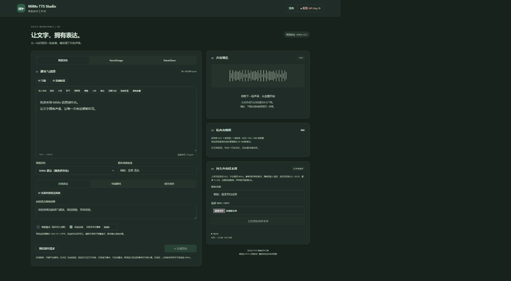
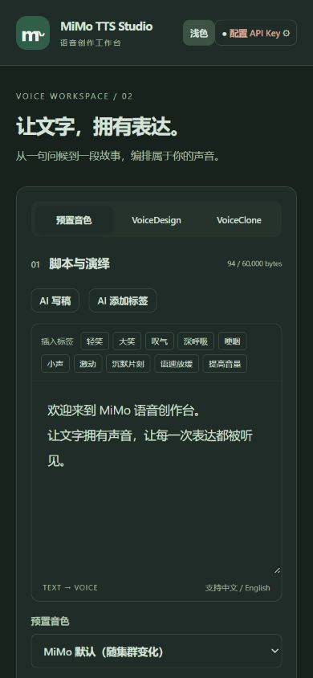
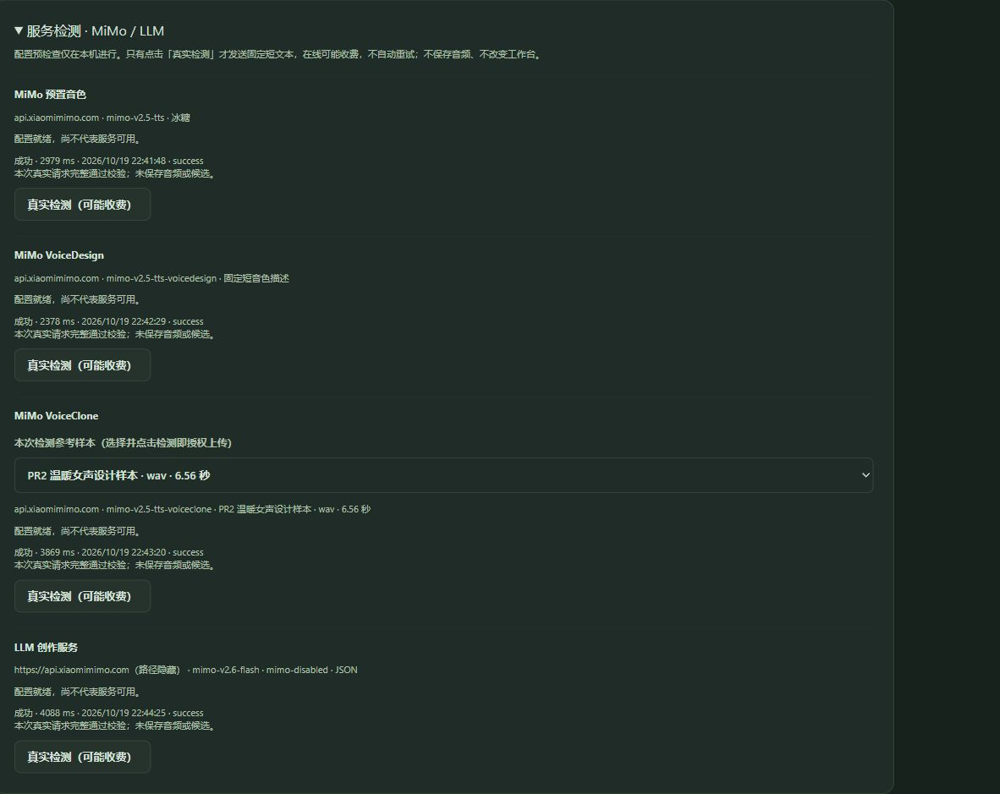
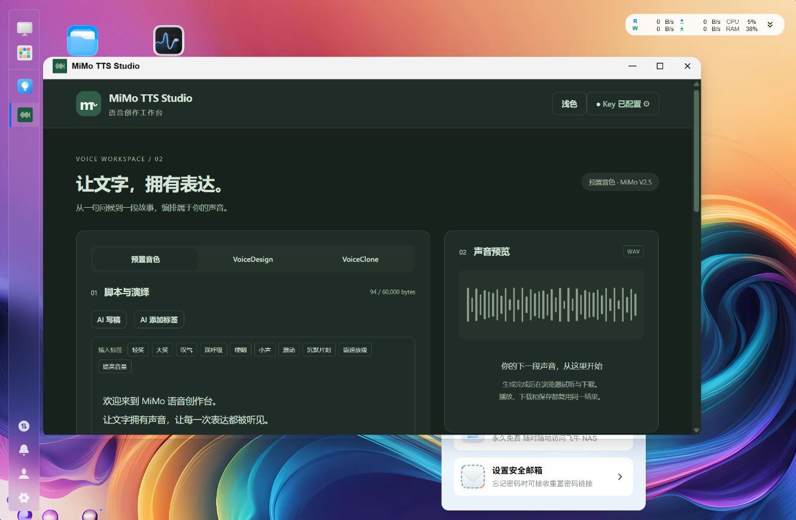
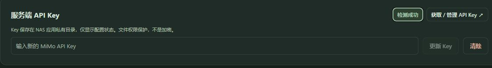
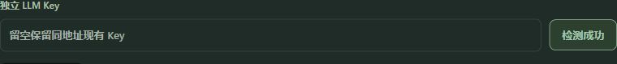

# PR4 — 服务可用性检测与深色模式

日期：2026-10-19（Asia/Shanghai）。基线：PR3 合并后的 `c959e84`，分支 `codex/pr4-service-diagnostics-dark-mode`。当前 FPK **0.4.3**（后续按钮调整见文末）。代码独立实现，只读查阅 SeleVox 诊断实现与 PR15 记录，没有复制 GPL 源码。

## 实现

- 设置区增加四项服务检测。离线预检查与真实成功分开；固定非敏感输入、服务端保存配置/凭据快照、明确选择克隆样本、单次一次上游请求。MiMo 复用 Mimo / Composition / Wave；LLM 小范围抽取共用传输与 JSON/SSE 解析，保留原 Thinking 和 Streaming。
- 独立单槽、不排队、90 秒总超时、真实取消确认。正常 TTS/AI 的状态和取消互不影响；不调用 Jobs.Start / Storage.Commit，不创建音频、候选或样本。HTTP 类别直接来自结构化状态码，不解析本地化错误，不返回上游正文、Key 或 URL 路径。
- 随机配置修订号不包含凭据或其可逆表示，服务端检测前后比较快照。UI 保护未保存变更，并对配置/样本变化、取消、关闭和迟到响应作废；面板只定时读取本机配置，绝不定时调用云端。
- 全部原 CSS 颜色替换为有名变量，浅色值保留，深色延续鼠尾草绿和墨绿。导航栏增加主题入口，只保存本地主题偏好；同步外部初始化脚本在应用加载前设置主题，存储不可用回退浅色。未改变原有字体、间距、尺寸、边框宽度、阴影范围或断点。
- 版本递增到 0.4.1。未修改持久数据格式、生命周期及权限模型。0.4.1 包含验收中的状态文案修正（检测繁忙独立分类、首次样本选择显示配置就绪）与颜色变量命名整理。

## 受控验证

| 层级 | 实际结果 |
| --- | --- |
| .NET Release | Windows 190 项；WSL Linux 193 项通过，Linux 多出私有权限断言 |
| Vue / Vite | 类型检查和生产构建通过；同步 public 初始化脚本按预期保留为经典脚本，Vite 提示不作模块捆绑 |
| 前端组件 | Vitest / happy-dom 20 项通过：原有 AI 候选 8 项，检测与主题 12 项 |
| 原有轮询 | Node 2 项通过 |
| Release Unix Socket | 62 项通过，包括新增检测管理员、Origin/CSRF、离线预检查、真实 loopback LLM 一次请求与凭据隐藏 |
| 生命周期 | 原 6 项通过，覆盖升级、保留/恢复、私有权限、永久删除范围和 symlink 拒绝 |
| 主题约束 | `tests/theme_styles.py` 通过：展开浅色变量后，全部 PR3 既有 CSS 声明保持一致（white / #fff 等价） |
| 打包 | Linux x86-64 self-contained publish、官方 fnpack 1.2.3、`tests/package.py` 通过 |

后端新增覆盖三模型的真实请求形状、完整有效 WAV、缺失/空/无效音频、跨用户样本拒绝、配置与 Key 过期、401/403/429/400/422/503 无重试与脱敏、取消/超时、忽略取消后迟到的有效音频、并发拒绝、LLM JSON/SSE/Thinking、缺 DONE/截断/仅 reasoning、零资产，以及取消检测不取消正常 TTS/AI。以上为受控 HTTP 和临时目录验证，不冒充真实云端。

## 浏览器配色与布局

- 本地 Edge 桌面 47 个主要元素在两种主题下位置、尺寸和字号相同。390 × 844 视口的 10 个主要区域几何数据完全一致；文档宽度与视口同为 390，无横向溢出。测试后恢复视口。真实 fnOS 1100 × 596 桌面 iframe 中的 8 个区域也在浅/深色下几何一致。
- 目视检查工作台、设置、样本库、输入框、禁用按钮及预览配色；刷新保持深色。服务端原有素材与工作台输入在主题切换后保持。常规正文、输入、按钮与深色表面清楚可辨；浅色保留 PR3 原配色，未声称所有原有小字均通过 AA。
- 浅色保真有逐声明的静态证据；未实施同一环境的 PR3 / PR4 全页面逐像素差异分析。

## 真实 fnOS 与云端

测试机 fnOS 1.2.0800 / Linux x86-64。通过侧边浏览器登录应用中心，上传原生 FPK，实际执行 **0.3.3 → 0.4.0** 原位升级。版本文件与受保护 Socket API 已确认；升级前记录的 12 个私有配置、历史 WAV、样本及元数据文件逐一 SHA-256 比较一致，原库仍为 4 条音频 / 1 条样本。私有校验文件不提交、不输出 Key 或其哈希。

0.4.0 安装后的浏览器逐项主动点击：

| 服务 | 实际结果 |
| --- | --- |
| MiMo 预置 / 冰糖 | 成功，2979 ms |
| MiMo VoiceDesign | 成功，2378 ms |
| MiMo VoiceClone | 明确选择已有「PR2 温暖女声设计样本」后成功，3869 ms；未选择时按钮禁用 |
| LLM JSON | 保存的 `mimo-v2.6-flash` / `mimo-disabled`，成功，4088 ms |
| LLM SSE | 设备端通过同一管理员 / CSRF API，临时保存 Streaming=true 后检测成功，3027 ms；随后恢复原设置，12 个文件再次校验一致 |

检测后工作台原稿不变，仍为 4 条音频 / 1 条样本，未产生诊断音频或候选。浏览器修改但不保存 LLM 模型，旧结果立刻过期且阻止检测；恢复输入没有写入服务端。

在浏览器上传问题排查期间，另曾在设备独立私有临时目录运行从 FPK 解出的 Release 实例；四项真实调用均成功（预置 1603 ms、设计 1419 ms、克隆 81009 ms、LLM 3535 ms），无新增任务/资产。该结果与实际安装分开记录；临时实例已停止，临时凭据与样本副本在验收结束清理。

## 最终 0.4.1 设备核对

继续通过应用中心上传新版本，实际执行 **0.4.0 → 0.4.1** 原位升级。最终设备安装 DLL 的 SHA-256 与本地 FPK 内 DLL 一致（`7b217447365072f8a2da8437f5f1da1225aa91a650550d969bfb6e0e29ef10ad`）。

最终包再次经真实管理员 / CSRF Socket API 主动执行四项检测：预置 **1444 ms**、VoiceDesign **1137 ms**、明确指定原有样本的 VoiceClone **4070 ms**、保存的 LLM JSON **864 ms**，全部成功。无新增任务、音频或样本，升级前的 12 个私有/历史文件仍逐一一致。此前真实 SSE 和截图来自 0.4.0，共用传输与解析在最终包中保持一致。

最终包实际执行 `appcenter-cli stop`、`status`（stopped）及 `start` 后，管理员 API、Socket 0600、已保存配置和 12 个原文件再次通过核对。重新从 fnOS 桌面打开真实 iframe 后仍为深色。浏览器打开原 PR3 历史 WAV 并播放至结束（3.68 秒），随后下载并用 Python wave 验证为 176684 bytes、24 kHz、单声道 PCM16；SHA-256 与 PR3 原结果一致。主题切换保留播放器 src、已播放位置和 readyState=4，未触发合成。

独立临时实例已停止，其目录、凭据/样本副本及私有基线文件均已清理，未改变已安装应用的数据。

## 0.4.1 产物（历史记录）

`artifacts/mimotts.fpk`，**0.4.1**，49,398,961 bytes，SHA-256 `e9d26c9d5998b8a4b05f64960ea6a4811a0a05783a364573b2e6f87520bae41c`。二进制不提交 Git，可按 README 重建。

## 未验证与限制

- 自定义供应商、真实云端错误码与限流、真实服务超时/断网均未逐个制造；相应分支由受控 HTTP 测试覆盖。
- 真实服务并发创作与检测未作收费压测；独立正常 TTS/AI 的取消隔离有受控并发测试。
- 独立非管理员 fnOS 会话、最小系统版本、外部 HTTPS/FN Connect、真实卸载/重装、磁盘耗尽及断电未实测。
- 没有人工音质评判或云端账单审计；诊断成功只表示本次请求完整且响应合法。

## 后续设置区调整（0.4.3）

按用户后续要求：

- 「获取 / 管理 API Key」左侧增加 MiMo「检测服务」快捷按钮；独立 LLM Key 输入行最右侧增加同样入口。
- 原检测面板中的按钮改为「服务检测」。所有入口共用同一个检测执行和结果状态：未检测时普通配色，成功显示绿色「检测成功」，失败显示红色「检测失败」；检测中禁止重复提交，配置变化使旧状态失效。
- 移除界面与按钮 tooltip 中重复的在线收费提示，保留固定输入、云端发送范围、克隆样本授权、无自动重试等说明。没有更改上游请求协议或增加自动在线请求。
- 官方 LLM 复用 TTS Key 时，编辑尚未保存的 TTS Key 也会禁用 LLM 检测并使旧状态失效。

实际验证：前端类型检查、生产构建、26 项组件测试（含新增 6 项快捷入口/变色/文案/未保存设置测试）、Linux .NET 193 项、浅色 CSS 保真和 FPK 包检查均通过。

设备先更新到 0.4.2 验证位置和共享变色状态，再更新至最终 **0.4.3**。0.4.2 的两次快捷检测真实完成（MiMo 1949 ms、LLM 28395 ms），快捷入口与折叠面板的成功颜色一致。LLM 输入与按钮垂直中心差为 0，按钮右边缘与输入行右边缘一致。最终 0.4.3 再次核对两处按钮的「检测成功」文案。失败红色和「检测失败」、配置过期恢复普通状态由受控组件测试覆盖，没有刻意修改真实服务凭据制造失败。

升级前记录的 12 个私有配置、WAV、样本文件在 0.4.3 下逐一校验不变。版本与安装 DLL 哈希均核对一致。

最终产物：`artifacts/mimotts.fpk`，**0.4.3**，49,399,523 bytes，SHA-256 `5228549edcef4915e9f6ad8a6b4feaf493f5117611059077c802c51a354231ae`。

