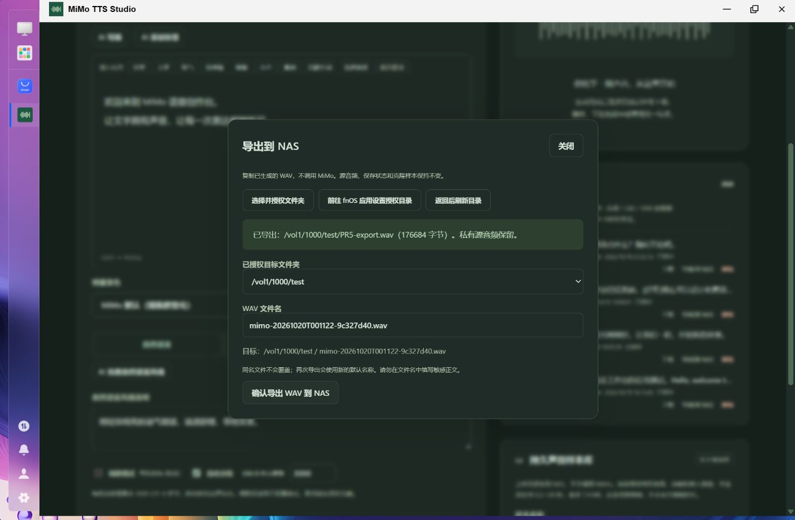
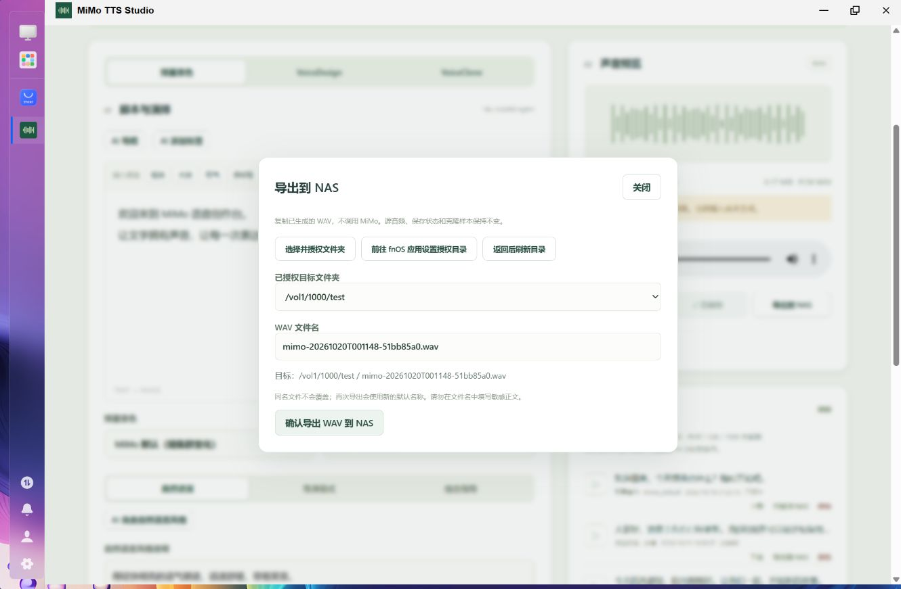
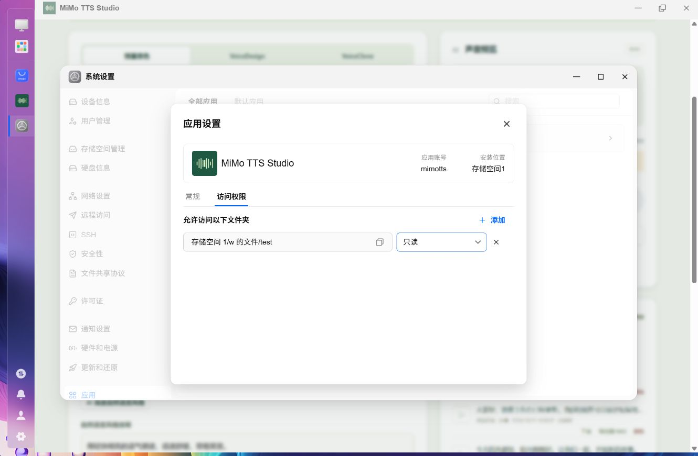
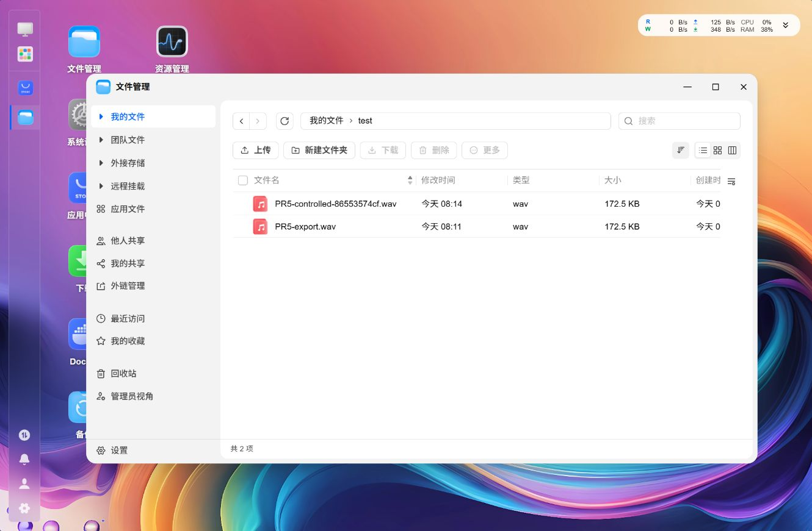

# PR5 — 导出既有 WAV 到 fnOS 授权目录

日期：2026-10-20（Asia/Shanghai）。基线：PR4 合并后的 `dafadbe0`。最终 FPK **0.5.1**，Linux x86-64；未访问 SeleVox。

## 实现与平台依据

- 当前结果和历史库新增轻量导出面板，沿用原布局及两套颜色变量。选择服务端目录 ID、确认单个 WAV 文件名、展示目标和成功/失败反馈；默认名称只有时间戳和随机值，HTTP 页面使用 `crypto.getRandomValues`。
- Manifest 设置 `disable_authorization_path=false`、`micro_app=true`；资源仅声明 `trim.file.sharedAccess` / `trim.file.userAcl`。保留 `run-as: package`，没有 data-share、额外自定义组、root 服务或目标目录 chmod/chown。
- 官方 SDK `@trimjs/web-app` **0.5.0**：`ready`、`pickSharedFile`、`openAppSetting`。宿主初始化有超时，管理员在原生选择器内操作没有八秒倒计时；返回后自动刷新，也保留手动刷新和无桥接时的原生设置步骤。
- 后端每次通过 `/var/run/trim_open_gateway_apiscope.socket` → `POST /api/v1/trimapp` 查询 `trim.file.getSharedAccessibleFolders`，按可信 UID 调用 `trim.file.checkUserACL`，服务端 token 只从 `TRIM_API_TOKEN` 取用。没有浏览器 token、任意路径 API、启动环境目录缓存或自建全盘浏览器。后端还用匿名文件验证包用户实际可写。
- 官方接口需要 fnOS **1.2.0401+**；保留原整体最低版本 `1.1.3100`，低版本导出明确不可用，其余功能保持原行为。当前实机 **1.2.0800 / Debian 12 / x86-64 / ext4**；无需配置回调或重启才能刷新目录授权。
- 依据：[官方调用方式](https://developer.fnnas.com/api/calling)、[共享授权](https://developer.fnnas.com/api/authorization/shared-access)、[用户 ACL](https://developer.fnnas.com/api/authorization/file-acl)、[页面路由](https://developer.fnnas.com/api/page/routing)、[环境变量](https://developer.fnnas.com/docs/core-concepts/environment-variables/)。实际读取官方 `https://developer.fnnas.com/llms-full.txt`；同时核对任务给定的公开文档镜像。没有猜测 SDK 方法。

## 文件与权限边界

所有新 API 沿用可信 root 网关对端、管理员身份、Origin/CSRF、128 KiB 请求体和资产 Owner 校验。仅接受当前授权根的进程内 HMAC ID，拒绝任意路径、私有目录祖先及系统目录；客户端无法选择子路径。

逐级 `openat(O_NOFOLLOW)` 固定目录句柄，祖先使用 `O_PATH`（fnOS 的祖先只有穿越权限），最终目录保留可同步句柄。64 KiB 缓冲、有界复制、64 MiB 上限、全应用一个导出、两分钟预算；源文件长度和实际复制长度一致并 `fsync` 后，使用 `linkat` 原子创建最终名称。已存在的普通文件或软链接均 EEXIST，不覆盖。

目标匿名 `O_TMPFILE` 与最终文件位于同一文件系统，支持源和目标跨卷。失败/取消释放匿名 inode，不需要临时文件名，也不扫描或清理用户目录；进程退出时由内核关闭句柄。不支持该能力的文件系统失败关闭。提交前重新查询授权、用户 ACL，并重开路径比对设备号/inode。最终 link 同时接受内核当前目录权限检查。平台权限查询与文件提交没有跨系统事务锁；已提交的完整外部文件不会因随后撤权被删除。提交后若目录同步失败，会提示已完整提交、先核实目标，不进行有竞态的回滚删除。

没有更改 Storage.Save/Commit/Delete、私有数据格式、样本、TTS/LLM 或生命周期脚本。导出类不依赖 Mimo/Jobs；播放、下载、保存、导出均重用成功结果。

## 受控验证

| 层级 | 实际结果 |
| --- | --- |
| Windows Release | 201 项通过；Linux 文件系统检查明确跳过 |
| Linux Release / 非 root | **235 项通过**，包含原有生成、样本、AI、诊断以及新增文件名、源不变、权限和竞态验证 |
| 文件系统 | 专用临时目录与两个 tmpfs：跨文件系统字节一致；64 KiB tmpfs 对 2 MiB WAV 产生真实 ENOSPC，零命名残留；实际目录无写权限、仅穿越祖先、目标丢失均覆盖 |
| 安全与竞争 | 非归属资产、绝对路径充当 ID、撤权后旧 ID、只读、提交查询期间撤权、目录 inode 替换、目录/文件 symlink、相邻目录、8 个独立导出实例争同名仅一个成功；复制完成后取消不提交 WAV |
| Release Unix Socket | **69 项通过**，新增列表/导出的管理员、Origin、CSRF、请求体限制、无平台授权时关闭功能，以及原有 LLM、诊断、上传等回归 |
| 前端 | 类型检查/生产构建通过；**33 项组件测试**与 **2 项 Node 轮询测试**通过，包含目录刷新、禁用只读、确认 ID/文件名、同名反馈、防重复、无桥接、迟到响应丢弃 |
| CSS / 生命周期 | 原浅色声明保真检查、原有 **6 项生命周期测试**通过 |
| 打包 | 仓库既有官方 fnpack 工具、自包含 Linux x86-64 publish、包结构/权限/scope/清洁内容检查通过 |

复现：`bash tests/nas_filesystems.sh` 只能在独立 Linux / WSL 受控主机以 root 运行，实际 .NET 检查降权到 nobody；不会用于冒充 fnOS ACL。`tests/fnos_pr5.py` 则验证实际安装服务的明确目标/源资产，模拟网关的客户端为 root，执行文件操作的后端仍为包用户；不更改平台授权，不调用云端。

## 真实 fnOS 验收

所有浏览器验收按用户要求在侧边浏览器进行。设备只有一个实际存储空间 `/vol1`（ext4）。

1. 应用中心手动上传 FPK，实际 **0.4.3 → 0.5.0 → 0.5.1** 原位升级；最终设备 DLL SHA-256 与最终 FPK 相同：`d18e513f974fee7319727728afea678ced2194de71cbdcf6792d07037c0bb2c7`。初版 0.5.0 曾用于排查 HTTP randomUUID、SDK 选择器超时和祖先只穿越权限，期间临时部署过前端；最终结论来自重新安装的完整 0.5.1。
2. 升级前记录的 **12 个原有 TTS/LLM 配置、历史 WAV、样本与元数据文件**，升级后、导出后及停止/启动后逐一 SHA-256 相同。私有比对文件留在设备临时私有位置，不提交，也不输出 Key/Key 哈希。
3. 在工作台点击官方原生目录选择器，选择已有 `/vol1/1000/test`；应用设置显示「读写」。`openAppSetting` 实际打开系统设置 → 应用 → MiMo TTS Studio → 访问权限。应用没有新增自建共享目录或放开宿主权限。
4. 最终 0.5.1 从历史音频导出 **PR5-export.wav**。工作台返回 176684 bytes；目标与原 WAV 逐字节/哈希一致，24 kHz、单声道 PCM16、88320 帧（3.68 秒）。真实用户 `w` 可以读取全部字节。随后在当前结果区打开同一历史资产，导出入口正常。
5. 再以同名导出，明确显示「目标已有同名文件」，原文件不变。受控脚本再导出独立随机名并验证同名失败，源字节、metadata、Jobs 列表和样本列表均不变，没有新 TTS Job。
6. 在原生应用设置把目录设为「只读」，使用原 ID 调用最终安装版导出，400、无目标文件；再通过平台设置移除授权，旧 ID 再次 400、无目标文件。刷新面板清除旧选项并禁用确认。已导出的 WAV 仍存在。全程不需重启服务；随后通过原生选择器恢复读写，回调自动刷新成功。
7. 使用明确标记的临时私有副本作为一次性源，调用真实导出 API，再通过 Delete API 删除这份测试源；外部 **PR5-source-delete-check.wav** 仍完整。原有四条资产从未删除。
8. 实际 `appcenter-cli stop/status/start/status` 得到 stopped/running，外部 WAV 保留，12 个原文件仍一致。应用 Socket 保持私有，配置和音频库可用。
9. 飞牛文件管理器中可见目标 WAV（所有者 mimotts，172.5 KB）；通过文件管理器真实下载到电脑，SHA-256 **`d5f987c5b60e0f12e47fa23ca2ab3068d252d3cdd9c5c6bf4628ddfcf0348190`**，与源/目标一致。设备只安装 MiMo，无音乐/预览应用；双击没有系统播放器。因此本记录**不声称飞牛播放器播放通过**。WAV 完整结构、读取和下载已验证。
10. 深色成功面板、浅色确认面板、历史与当前结果入口均目视检查，延续原左右布局。没有重新发起真实 MiMo/LLM 生成或诊断收费请求。

## 最终产物与限制

`artifacts/mimotts.fpk`，**0.5.1**，**49,414,982 bytes**，SHA-256 **`d3f112983e759575671c8074c0445ffe7b69391e222b14be02c3c7d11b644bc3`**。二进制不提交 Git。

- 无第二个真实 fnOS 存储空间：跨文件系统只在受控 Linux tmpfs 验证，未冒充第二空间 ACL 测试。
- 飞牛原生播放器未安装，文件管理器播放未完成；真实下载与完整 WAV 已验证。
- 未实际卸载现有设备应用；卸载脚本保持原样且不接触授权目录，原 6 项生命周期回归通过。没有声称实机卸载验收通过。
- 未在设备制造 ENOSPC/断电/强杀、真实外接/远程文件系统、最小 fnOS 版本、App 移动宿主或非管理员真实浏览器会话；相应受控检查与实机证据分开。进程异常回收使用 Linux O_TMPFILE 语义，未进行断电持久性实测。
- 旧系统缺少目录开放 API 时仅 NAS 导出不可用；不会降级为信任过期环境变量或自定义系统权限。
