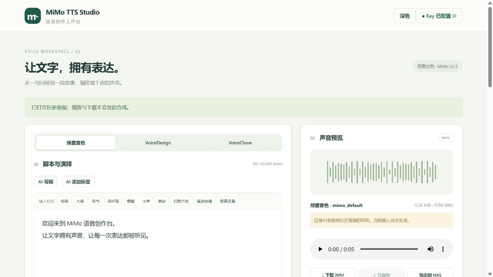
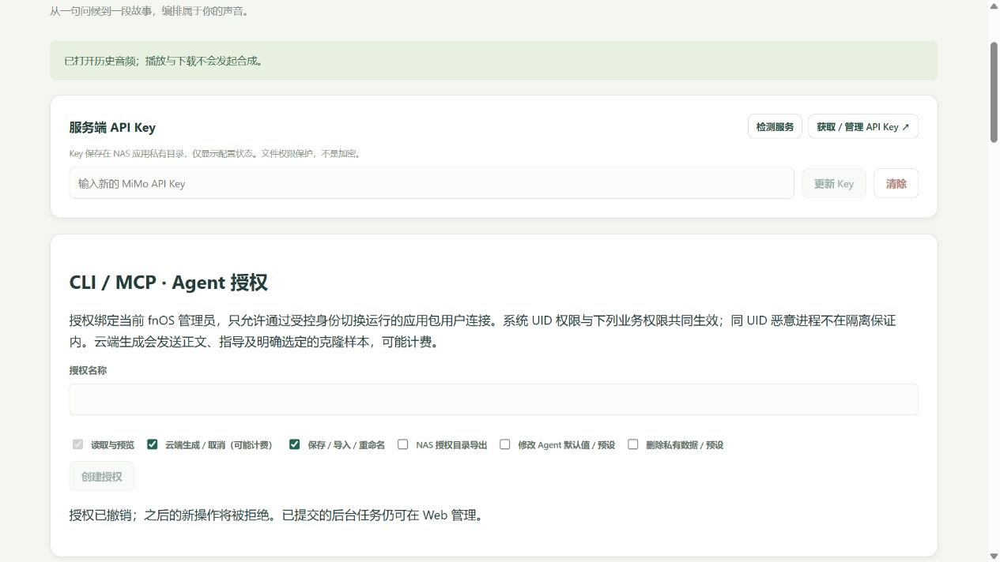

# PR7 — CLI / MCP / Agent（FPK 0.7.1）

2026-10-20；基线 `c8f702c`（PR6 合并后 main / 0.6.2）。按用户要求直接在 `D:\Projects\MiMo-TTS-Studio` 工作，本地 main 已快进至 origin/main；PR7 分支 `codex/pr7-agent`。临时独立 PR7 工作目录已移除，原未跟踪开发数据保留。SeleVox 仅只读理解文档/接口结构，没有复制其 GPL 源码，也没有修改或依赖该工程。

## 实际交付

- Linux x86-64 自包含 `MiMoStudio.Agent`，37 项 CLI 操作、35 项标准 MCP stdio 工具，官方 MCP C# SDK **2.2.0**。完整命令/具体 Schema/范围/退出码/SSH 示例在 [CLI-MCP.md](../docs/CLI-MCP.md)。
- 两个客户端通过同一 v1 私有 UDS/AgentExecution，调用运行中的同一 Storage、Jobs、Mimo、Llm、Diagnostics、NasExport。Web 路由与原鉴权不改；没有第二任务队列、LLM/TTS 实例、文件库、TCP 或网络 MCP 服务。
- Web 设置轻量创建/查看/撤销授权，绑定可信 fnOS 创建者 Owner；系统真实 Linux 包 UID + 随机秘密 + scope 校验。授权/默认值/命名预设在私有 var/agent，配置总量256 KiB、原子写、并发锁，支持升级保留和有归属的确认删除。
- 三模式/原样 Unicode/标签/导演/唱歌/安全分段、本地最终预览、六类 AI 候选、任务查询/取消/等待、样本与音频库管理、原 NAS 导出和检测均复用既有业务。只有 CLI 提供显式文件导入/下载；MCP 不接受宿主路径或输出音频 Base64。
- TTS 同授权、同进程幂等256条；重启后不保证去重。等待/客户端断开不取消后台 Job，取消有独立命令。API Key/URL 仍只在原 Web 设置管理。

## 自动化证据（分层）

| 层级 | 实际执行结果 |
| --- | --- |
| .NET Release / 受控 HTTP | Windows 阶段319项；最终 Linux **非 root 324项**通过，包括原三模式、SSE、标签原文校验、WAV/MP3、并发/取消、NAS，以及新增授权、幂等、预设/默认继承/清空/并发、严格参数/CLI、MCP输入上限。模拟 HTTP 是受控响应，不记为真实云端。 |
| 真实 Linux IPC / CLI | `agent_ipc.py` **60项**：最终发布程序以 nobody 运行；0600 Socket/凭据、真实 peer UID、root错误对端拒绝、不同Owner拒绝、UTF-8/CRLF、大小/未知字段、凭据链接拒绝、样本导入/重命名、WAV下载字节一致/禁止覆盖、共享参数预览、撤权及停止清理。 |
| 标准 MCP 客户端 | 官方 SDK `McpClient` 真正启动自包含 Agent，initialize、35工具、structuredContent、isError 通过；另以原始换行JSON-RPC测试 initialize/tools/list/tools/call/取消通知/EOF；stdout纯协议。CLI 与 MCP 对同一参数的整个有效 Composition 逐字段相等。 |
| CLI 等待时限 | 独立受控 IPC 响应 `cli_wait.py`：持续 running 时 `--wait --timeout 1` 退出7/timeout，收到的客户端命令全部为状态查询，零取消/重提。这是模拟 IPC 客户端行为测试，不冒充真实 MiMo 超时。 |
| Vue / Node | 类型检查/生产构建通过，**69项组件测试 + 2项Node轮询测试**通过；含新增授权界面默认权限/创建/撤销。 |
| 目录 / 生命周期 / 包 | 8类48项 Agent 目录与PR6 UI逐项一致；6项生命周期检查包含Agent保留/确认删除；浅色CSS保真检查通过；官方fnpack、自包含publish、两套运行时/ELF/执行位/SDK许可/干净包检查通过。 |
| 原 Web 网关 | 最终发布 backend **69项真实 Unix Socket 集成检查**通过；root测试客户端模拟可信网关，服务为非root。伪造管理员Header、Origin/CSRF、样本上传边界、LLM本地受控服务、NAS失效拒绝均覆盖；不是fnOS宿主验证。 |

复现（Windows/WSL 共用 obj，.NET 构建串行）：

```bash
npm --prefix frontend ci
npm --prefix frontend run build
npm --prefix frontend exec -- vitest run --root frontend --environment happy-dom tests/styles.test.js tests/style-workbench.test.js tests/creative.test.js tests/diagnostics.test.js tests/nas-export.test.js tests/probe-buttons.test.js tests/agent-settings.test.js
node --test frontend/tests/polling.test.mjs
dotnet build tests/Studio.Tests.csproj -c Release
# Linux 已有 nobody，测试临时目录由测试自行创建：
sudo -u nobody dotnet tests/bin/Release/net10.0/Studio.Tests.dll
bash scripts/build.sh --frontend-built
sudo python3 tests/production_gateway.py artifacts/fpk/app/server/MiMoStudio
sudo python3 tests/agent_ipc.py
sudo -u nobody python3 tests/cli_wait.py artifacts/fpk/app/agent/MiMoStudio.Agent
python3 tests/lifecycle.py
python3 tests/agent_catalog.py
python3 tests/theme_styles.py
python3 tests/package.py
```

首次打包因新NuGet包缺失随包许可文件而阻止，已按精确仓库commit补齐官方许可与 notices，并重构建通过。一次广泛Vitest发现了应由Node运行的 polling.test.mjs；按上述分开的正确runner全部通过。中间换行/共享构建文件引起的打包中止没有用于最终交付；最终包是在源码固定、串行publish后一次完整成功构建的产物。

## 真实 fnOS / 真实云端

测试 NAS `192.168.3.153`，fnOS **1.2.0800 / x86-64**；Web 操作全部使用用户指定的侧边浏览器。通过应用中心上传原位升级 **0.6.2 → 0.7.0 → 0.7.1**。安装前在设备root私有临时文件记录原17个配置/历史音频/样本文件哈希；最终升级、取消、停止重启和撤权后逐一一致。没有输出凭据或其哈希；临时基线和凭据副本在结束后移除。

真实管理员Web设置创建验收授权，Owner=1000，按勾选的scope保存；秘密仅在包私有文件。CLI/MCP均以包用户 `mimotts` 运行。普通SSH用户 `w` 直接读取凭据退出3；0600 Web/Agent Socket，进程无TCP监听。没有修改Socket权限、sudoers、宽泛系统组或部署root服务。

### 真实 MiMo 和共享资源

以下三模式完整工作流在 **0.7.0** 完成，均是当前配置的真实 MiMo，无自动重试：

| 模式 | 资产 ID | 实际 PCM WAV |
| --- | --- | --- |
| Preset | `8a0ee9f616e44d138d4f0fda2c9a44a0` | 24000Hz / mono / PCM16，276480帧，11.52秒，553004 bytes；2段，整体标签+自然/导演组合+句内标签 |
| VoiceDesign | `84f0c21ab2274fc7b08493d1ac0aa31d` | 24000Hz / mono / PCM16，165120帧，6.88秒，330284 bytes；描述与导演指导 |
| VoiceClone | `34f69dc505fd40898fb859243292b8fe` | 24000Hz / mono / PCM16，157440帧，6.56秒，314924 bytes；明确选新设计样本，整体/句内标签 |

1. Preset 提交后 CLI 已退出，后端2段继续并成功；相同requestId重提返回同Job，第二个新任务被全局busy拒绝。没有把查询/保存/下载当作再次合成。
2. Design 结果成功创建独立样本 `c6fd7f87914142ed8733df7b064a2b87`（PR7 Agent VoiceDesign 样本），再从样本执行上述Clone。三个结果均标记保存。
3. Clone 通过原 NasExport 导出到原有实时授权目录 `/vol1/1000/test/PR7-agent-2cc6119f.wav`，同名再导出被拒绝。外部文件与私有 WAV 字节完全一致；原PR6导出文件哈希保持一致。
4. CLI下载与私有源SHA-256一致；再次同输出路径下载拒绝覆盖。显式导入此WAV、重命名、删除临时样本成功，没有额外TTS。新Design样本和四个成功验收音频保留在Web库，原样本未改动。
5. 六种真实LLM操作全部返回经既有验证的有效候选：描述、自然风格、导演三字段、稿件、歌词、严格句内标签。无Web草稿改写、音频上传或自动TTS。随后 preset/design/clone/llm 四项真实主动检测均 succeeded；clone 明确指定新样本，检测没有保存音频。

### 最终 0.7.1 / SSH / 生命周期

0.7.1 补充严格Schema、导入增长限制、MCP消息/并发上限和响应发送预算等边界修正，原MiMo/LLM/WAV/NasExport核心未修改。最终包再次原位升级后核对安装的 server、Agent、Shared DLL 与最终FPK字节一致；原17文件、Agent预设、样本和目录授权保持。

- 官方C# SDK客户端经**真实SSH通道**启动NAS上的自包含MCP：initialize、35工具发现、结构化调用/错误成功，并真实提交/等待/保存 `0a6dafdd28c144bfbc0d41daa5e9997d`。Web重新打开显示同一新资产及原三模式结果；10条音频/2条样本，历史播放/下载入口正常。
- 此SSH实测使用用户授权的密码式SSH及sudo安全输入，由私有测试relay分离认证输入和MCP stdin/stdout，再以 `sudo -u mimotts` 执行。**没有配置或实测SSH key +窄免密sudo规则**；文档中的通用 `ssh -T ... sudo -n ...` 示例要求管理员已有该受控能力，不能将本次relay成功宣称为任意普通SSH账户开箱即用。relay未打包，也不提交密码或连接秘密。
- 最终安装版真实发起临时多段任务，明确取消，查询到canceled且无Asset；新任务通过MCP提交后关闭stdio/MCP进程，后端仍running；取消旧ID不影响新任务。
- 对仍running的新任务执行实际 `appcenter-cli stop/status/start/status`，停止时两只Socket移除；重启后 running、两Socket0600、无半成品成功资产、原文件及预设不变。旧Job状态沿用进程内历史边界，查询不存在；20分钟后端总预算不因断开消失。
- 在最终Web设置撤销授权。撤销前已打开的真实MCP连接使用一份**仍存在、0600且同包UID的旧凭据副本**调用新合成，服务端明确 permission_denied / isError；没有云请求。副本随后删除，最终授权列表为空，原成功资产/Design样本/NAS外部WAV仍保留。

实机脚本：`tests/fnos_pr7.py --grant ID --online`、`tests/fnos_pr7_lifecycle.py --grant ID --online`、`tests/fnos_pr7_revoke.py --grant ID`。前两者明确计费或取消在途计费请求；撤销脚本需配合真实Web撤销。官方客户端源为 `mcp-tests/`，`MIMO_MCP_LIVE=1` 才提交真实生成；默认协议smoke不调用云端。




## 最终产物与限制

`artifacts/mimotts.fpk`：**0.7.1**，**87,504,250 bytes**，SHA-256 `b3ee0141aaeff668bfd3dec70456da263b6e8e495e61ee5358cf63e027eaf0ef`。包含两个Linux自包含程序、运行时与所有许可；无NAS SDK依赖。FPK二进制不提交Git。

最终包和实际安装：

- backend DLL：`04884a08614633f718b35ee17948646c7db6d43477c491bb5715dede29aeadc4`
- Agent DLL：`c4c32a92555d484fbe551c920e280ac1792b240b011971face1d6c559dec5697`
- Shared DLL：`447424d96f4951b3cb5cdc14d82ca3a5f479898f155ad6c53e1ca411234f52fd`

未做真实卸载/重装、断电/磁盘满/恶意宿主内核或最小系统版本测试；卸载保留/确认删除在隔离生命周期测试覆盖。唱歌请求形状及标签规则有受控HTTP/Composition证据，本次没有再次真实合成唱歌音频，也没有主观听感/克隆相似度评价。NAS目录撤权/文件系统负例复用原PR5实现和原测试证据，本次实机重跑了同名拒绝与原目录授权保留，没有改动现有授权目录。

同包UID完全被控制不在隔离保证内；远程身份切换是部署前提。幂等/Job历史重启边界明确，不提供跨重启计费事务或远程MCP任意文件传输。
